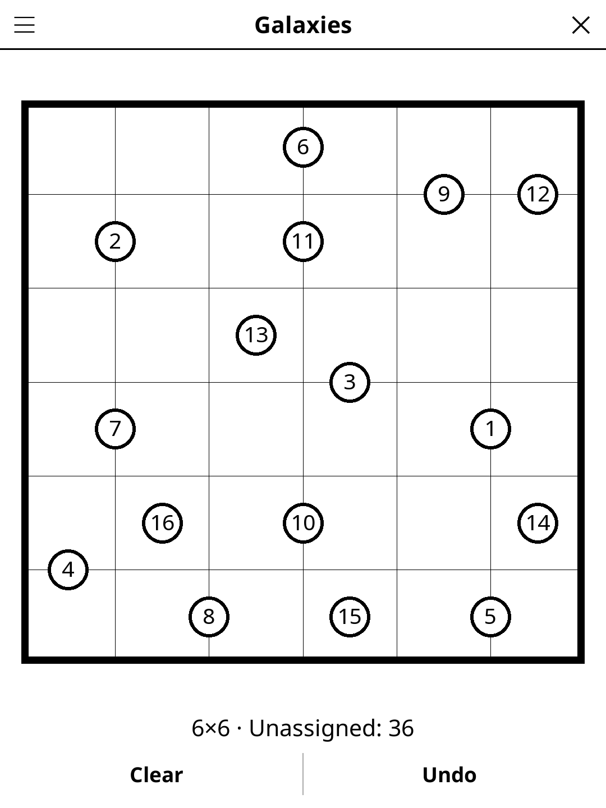

# galaxies.koplugin

A Galaxies (Tentai Show) puzzle plugin for [KOReader](https://github.com/koreader/koreader).

## Screenshot

## Rules

Divide the grid into regions, one per galaxy symbol. Each region must be **rotationally symmetric by 180°** around its galaxy symbol and **in one piece** (its cells touch side by side). Every cell belongs to exactly one galaxy region. Every puzzle has exactly one solution and can be solved by reasoning alone, without guessing.

## Features

- **Two grid sizes** — 6×6 and 8×8
- **Daily Challenge** — the same puzzle for everyone each day
- **Show solution**, **Clear** and **Undo**
- **Auto-save** — puzzle state saved and restored on next launch

## Installation

1. Download `galaxies.koplugin.zip` from the [latest release](../../releases/latest).
2. Extract into the `plugins/` folder of your KOReader data directory.
3. Restart KOReader.
4. Open the menu → **Tools** → **Games** → **Galaxies**.

## Controls

| Action | How |
|--------|-----|
| Assign cell to galaxy | Tap cell |
| Cycle through galaxies | Tap cell again |
| Undo last move | Tap **Undo** |
| Clear the grid | Tap **Clear** |
| New game, Daily Challenge, size, solution, rules | Menu (top left) |

## License

GPL-3.0 — see [LICENSE](LICENSE).
